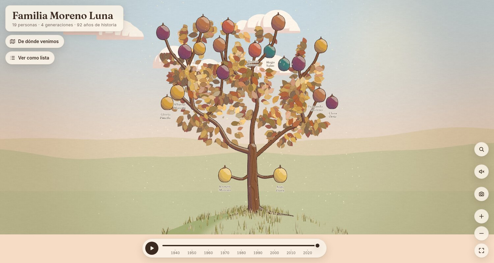
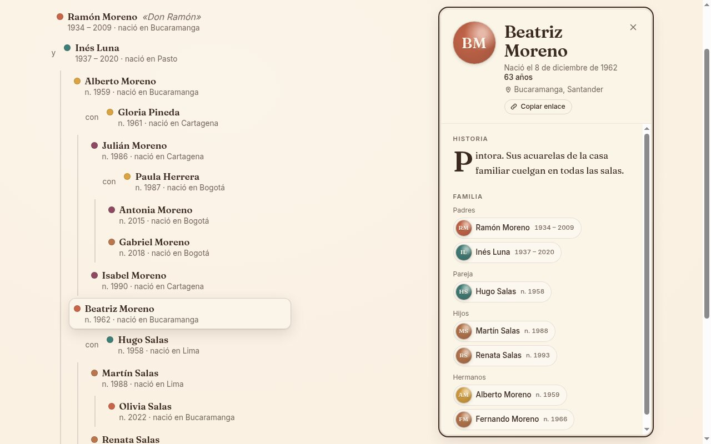

# Árbol Familiar Vivo

Un árbol genealógico que **crece frente a ti**. El tronco son los abuelos, cada rama es un hijo y cada persona es un fruto que se ilumina al tocarlo. Hecho con React Three Fiber y shaders propios, 100 % frontend.



> La demo pública usa una familia **ficticia** (la "Familia Moreno Luna"). El sitio de la familia real se construye aparte y no se publica en el portafolio.

## Qué hace

- **Intro:** cae una semilla, brota y el árbol crece generación por generación mientras la cámara se aleja.
- **La forma sale de los datos:** el grosor de cada rama depende de cuánta familia sale de ella. Dos familias distintas producen dos árboles distintos, y la misma familia produce siempre el mismo.
- **Vivo:** viento con ráfagas en ramas, hojas, pasto y frutos; estaciones según el mes, día y noche según la hora local (de noche los frutos son linternas y hay luciérnagas).
- **Personas:** al elegir a alguien, la cámara vuela hasta su fruto, una savia de luz sube por su linaje hasta el tronco y se abre su ficha con fotos tipo polaroid, historia, nota de voz y familiares.
- **Tiempo:** una línea de tiempo hace crecer o encoger el árbol año por año. Los fallecidos llevan un fruto dorado, y en su cumpleaños la rama de cada persona florece.
- **Extras:** mapa de orígenes con las migraciones por generación, música ambiental sintetizada, un pájaro que visita las ramas, modo foto y una firma escondida en la corteza.
- **Para todos:** vista en lista accesible con las mismas fichas (y como respaldo si no hay WebGL), navegación completa con teclado, `prefers-reduced-motion` en todo el sitio y calidad que se adapta sola al dispositivo.



## Arquitectura

Capas con dependencias en un solo sentido. `domain/` y `layout/` son TypeScript puro (ni React ni three), cubiertos por tests. ESLint hace cumplir las fronteras con `no-restricted-imports`.

```
family.json ──▶ data/      validación (zod + reglas de integridad)
                  │
                  ▼
               domain/     genealogía pura: ancestros, generaciones, fechas, búsqueda, orígenes
                  │
                  ▼
               layout/     familia ➜ geometría abstracta: curvas, radios, frutos, hojas (Vec3 propios)
                  │
     ┌────────── scene/    R3F: meshes, materiales, shaders, cámara, efectos
     │            ▲
 state/ (zustand) │        scene/ y ui/ nunca se importan entre sí: solo comparten el store
     │            ▼
     └────────── ui/       DOM: ficha, buscador, línea de tiempo, mapa, lista accesible
```

Más detalle en [`docs/arquitectura.md`](docs/arquitectura.md); el modelo de datos, en [`docs/datos.md`](docs/datos.md).

## Decisiones técnicas

**Layout determinista.** Toda la aleatoriedad (ángulos, curvas, hojas) sale de un PRNG con semilla (`layout/random.ts`, hash FNV-1a), sembrado por el `id` de cada persona. El mismo `family.json` produce exactamente el mismo árbol, en cualquier navegador, y agregar a una persona solo mueve su rincón del árbol. Hay tests de determinismo y de que los frutos no se encimen: un paso de relajación (`layout/relax.ts`) separa a los hermanos demasiado cercanos.

**Modelo de tuberías.** El grosor de las ramas sigue la regla de Leonardo: una rama transporta tanta "savia" como todo lo que alimenta, `rᵉ = Σ r_hijoᵉ` (`layout/thickness.ts`). Todas las puntas terminan con el mismo radio, así que una rama solo engorda si de ella cuelga más familia.

**Viento en GPU.** Un mismo campo de viento (`shaders/wind.glsl`) mueve ramas, hojas instanciadas y pasto en el vertex shader: una onda que recorre la copa, con ráfagas programadas. Los frutos son objetos de React con su propia física de resorte, así que el mismo campo tiene un gemelo en CPU (`scene/wind/windField.ts`) con la misma fórmula: así un fruto nunca se separa de su rama.

**Crecimiento y savia.** La intro y la línea de tiempo son el mismo shader (`shaders/growth.glsl`): cada vértice sabe cuándo lo alcanza la punta que crece (en segundos) y en qué año existe (en años), y se muestra según lo que llegue último. Al seleccionar a alguien, un frente de luz sube por la distancia acumulada a lo largo de su linaje (`layout/sapPath.ts` + `toon.frag.glsl`), mientras el resto se desatura y se desenfoca.

**Estética ilustrada.** Sombreado toon con 3–4 bandas y sombra teñida, contornos por casco invertido, y un pase propio de papel (fibras, aguadas, grano y viñeta) sobre `postprocessing`.

**Rendimiento.**

- `PerformanceMonitor` de drei mueve entre tres niveles de calidad (DPR, hojas, partículas, pasto, bloom, DOF). Un nivel que ya fue lento no se vuelve a intentar.
- Las hojas, el pasto y las partículas van instanciados.
- La primera pantalla es HTML y CSS puros, así que se pinta antes de que llegue el JavaScript.
- Postprocessing, mapa, modo foto y visor de fotos se cargan bajo demanda.
- zod no viaja a producción: el build valida los datos y se detiene si hay un error.

## Agregar personas

Todo el contenido está en [`src/data/family.json`](src/data/family.json): una lista de personas y una de uniones (parejas con hijos). Las fotos van en `public/media/people/<id>/` en `.webp`. Con Claude Code basta con pedirlo en lenguaje natural (comandos `/agregar-persona` y `/editar-persona`):

> Agrega a mi prima Ana, hija de Lucía y Pedro, nacida el 3 de marzo de 2003 en Cali.

Después:

```bash
pnpm validate:family   # ids, referencias, ciclos, fechas, archivos de fotos…
```

## Desarrollo

```bash
pnpm install
pnpm dev               # http://localhost:5173
pnpm test              # vitest
pnpm lint
pnpm build             # build "familia": datos reales
pnpm build:demo        # build "demo": familia ficticia, sin fotos reales
```

Parámetros útiles: `?quality=low|medium|high` fija la calidad, `?season=invierno&time=noche` fuerza el ambiente, `?lista` muestra la página sin WebGL y `?debug=layout&people=80` abre el visor del layout con una familia sintética.

## Despliegue

- **Demo (portafolio):** cada push a `main` la publica en GitHub Pages con `.github/workflows/deploy-demo.yml`. En el repositorio, la fuente de Pages debe ser _GitHub Actions_.
- **Familia:** `pnpm build` y sube `dist/` a cualquier hosting estático (Netlify, Vercel, Cloudflare Pages). Define `VITE_SITE_URL` con la URL final para que la vista previa de WhatsApp tenga una imagen absoluta.
- **CI:** `.github/workflows/ci.yml` corre lint, Prettier, tests, la validación de ambos datos y las dos builds en cada push.

## Problemas conocidos

- La consola muestra `THREE.Clock: This module has been deprecated`. Viene de React Three Fiber 9.8.2 (la última versión) con three 0.187, no de este código.
- El chunk de three pesa ~190 KB gzip: R3F importa todo el espacio de nombres de three, así que no se puede podar.

## Stack

Vite · React 19 · TypeScript estricto · React Three Fiber · drei · postprocessing · GSAP · zustand · zod · Vitest · ESLint · Prettier · pnpm
